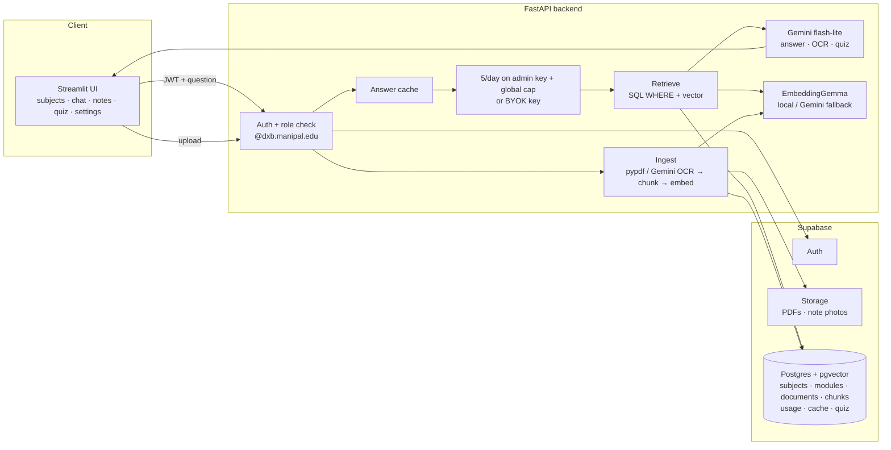

# Notes App: Project Plan (Codex builds, Rishi learns)

> A RAG app for lecture notes, for the CSE department at Manipal Dubai.
> Codex writes the code one phase at a time. You read it, run it, test it, and explain it back.
> Phases are in order. There are no dates.

---

## 1. Summary

Students open a subject, pick a module PDF, and ask questions. Answers come **only** from that module's notes (or the whole subject), always with sources (document · module · page). You (admin) upload the official notes and past papers. Students can add their own handwritten notes, which stay private. A quiz section turns past papers into practice and "likely" questions. Everyone gets 5 questions a day on your Gemini key (paid tier, billing on, ~$60 credits), with a token limit per answer. After that, they paste their own free Google AI Studio key (BYOK, never stored). A global daily cap, spend tracking and caching protect your credits. The repo is open source, and every part is free except Gemini usage on your key.

**Architecture (one question):**
```
Student (Streamlit) → FastAPI /ask → auth check → cache? → quota/BYOK
  → embed question (EmbeddingGemma) → pgvector search WHERE subject/module
  → top-k chunks → Gemini flash-lite (answer + [1][2] citations) → answer + sources
```

**Architecture (one upload):**
```
Admin uploads PDF → Supabase Storage (raw PDF) → pypdf pages → chunks (keep page no.)
  → EmbeddingGemma vectors (768) → chunks table (subject_id, module_id, source_type, page)
```



**Key decisions (and why):**
- **RAG core first** → everything else wraps around it.
- **pgvector, not Qdrant** → one database for users, quotas, quiz *and* vectors, and filters are plain SQL `WHERE`.
- **Chunks carry `subject_id`, `module_id`, `source_type` themselves** → filtering needs no joins, so it's fast and simple.
- **Streamlit talks only to FastAPI** → secrets stay on the backend.
- **LangChain only where it saves effort** (embeddings wrapper, text splitter, `init_chat_model`, structured output) → retrieval SQL stays hand-written so you understand it.

---

## 2. Final repo folder structure

```
notes-app/                      (public GitHub repo, MIT)
├── AGENTS.md                   rules Codex reads every session
├── README.md
├── LICENSE
├── .env.example                placeholders only (real .env is gitignored)
├── .gitignore
├── pyproject.toml / uv.lock
├── docs/
│   ├── PROJECT_PLAN.md         this file
│   ├── codex-prompts/          phase-00.md … phase-10.md
│   ├── DEPLOY.md               (phase 10)
│   └── BETA_TEST.md            (phase 10)
├── supabase/
│   ├── migrations/
│   │   ├── 0001_init.sql            subjects, modules, documents, chunks, vector index
│   │   ├── 0003_profiles_roles.sql  profiles, roles, RLS
│   │   ├── 0004_usage_cache.sql     usage_daily, answer_cache
│   │   ├── 0005_student_notes.sql   owner_id, is_shared
│   │   └── 0006_quiz.sql            past_paper_questions, quizzes, quiz_items
│   └── seed.sql                5 subjects + modules
├── app/                        FastAPI backend (Python package)
│   ├── main.py                 app + lifespan (loads embedding model once)
│   ├── config.py               settings from .env (SecretStr)
│   ├── db.py                   psycopg connection + pgvector
│   ├── embeddings.py           EmbeddingGemma (local) | Gemini (fallback)
│   ├── llm.py                  init_chat_model, BYOK key, 429 handling
│   ├── auth.py                 JWT check, domain check, require_role
│   ├── quota.py                5/day + global cap + spend estimate
│   ├── cache.py                answer cache
│   ├── storage.py              Supabase Storage upload + signed URLs
│   ├── ocr.py                  image prep + Gemini handwriting transcription
│   ├── schemas.py              Pydantic request/response models
│   ├── ingest/
│   │   ├── pdf_loader.py
│   │   ├── chunker.py
│   │   └── pipeline.py
│   ├── rag/
│   │   ├── retrieve.py         THE SQL (vector + WHERE filter)
│   │   ├── prompt.py           system prompt + numbered context
│   │   └── answer.py           text + image answers
│   ├── quiz/
│   │   ├── extract.py          past paper → questions (structured output)
│   │   ├── likely.py           group repeated questions, score by years
│   │   └── generate.py         practice quiz + model answers
│   └── routers/
│       ├── subjects.py  documents.py  ask.py  me.py
│       └── notes.py  papers.py  quiz.py
├── frontend/                   Streamlit
│   ├── app.py                  navigation + login gate
│   ├── api_client.py           httpx calls to FastAPI
│   └── pages/
│       ├── home.py  subject.py  settings.py  admin_upload.py
│       └── my_notes.py  past_papers.py  quiz.py
├── scripts/
│   ├── check_setup.py  ingest_pdf.py  ask.py  eval_retrieval.py
│   ├── get_token.py    reembed_all.py
├── tests/                      pytest, external calls mocked
├── data/                       gitignored (sample PDFs, eval questions)
├── Dockerfile / render.yaml    (phase 10)
└── .github/workflows/tests.yml (phase 10)
```

(`0002_` is skipped on purpose. Phase 3 only adds it if columns are missing.)

---

## 3. Database schema

Think of each table as one "thing" the app stores. The short SQL is below. Codex writes the full SQL with comments in the migrations.

```
subjects ─< modules ─< documents ─< chunks
                         │
profiles ─< documents (uploaded_by / owner_id)
profiles ─< usage_daily
documents(past_paper) ─< past_paper_questions
profiles ─< quizzes ─< quiz_items
answer_cache (stand-alone)
```

### Phase 0: core RAG tables
```sql
create extension if not exists vector;

create table subjects (
  id serial primary key,
  code text unique not null,          -- 'OS', 'SE', 'POC', 'CN', 'EOM'
  name text not null
);

create table modules (
  id serial primary key,
  subject_id int not null references subjects(id) on delete cascade,
  number int not null,
  title text not null,
  unique (subject_id, number)
);

create table documents (
  id uuid primary key default gen_random_uuid(),
  subject_id int not null references subjects(id),
  module_id int references modules(id),          -- null = whole-subject doc (e.g. past paper)
  source_type text not null check (source_type in ('official','student','past_paper')),
  title text not null,
  storage_path text,                             -- where the raw file lives in Supabase Storage
  page_count int,
  exam_year int,                                 -- past papers only
  status text not null default 'ready',          -- processing | ready | failed
  error text,
  uploaded_by uuid,                              -- FK added in phase 4
  created_at timestamptz default now()
);

create table chunks (
  id bigserial primary key,
  document_id uuid not null references documents(id) on delete cascade,
  subject_id int not null,                       -- copied from document → filter without joins
  module_id int,
  source_type text not null,
  page int not null,                             -- for "p.14" in sources
  chunk_index int not null,
  content text not null,
  embedding vector(768) not null,
  embedding_model text not null,                 -- never mix models in one search
  created_at timestamptz default now()
);

create index on chunks using hnsw (embedding vector_cosine_ops);
create index on chunks (subject_id, module_id, source_type);
```

| Table | Why it exists |
|---|---|
| `subjects` | The home-page cards (5: OS, SE, POC, CN, EOM). The top-level filter. |
| `modules` | "Ask only Module 2" = `WHERE module_id = 2`. |
| `documents` | One row per uploaded file. It links the raw PDF (Storage) to its chunks, tracks status, and is deleted in one go (cascade). |
| `chunks` | The searchable pieces: text + vector + filter columns + page. **This is the heart of RAG.** |

**Why copy `subject_id`/`module_id`/`source_type` into `chunks`?** Search becomes one table with one `WHERE`, so it's fast and easy to read. The cost is a little duplicated data. That's a normal trade-off called *denormalization*.

**Why `embedding_model`?** Vectors from two models live in different "spaces", so comparing them is meaningless. If you switch to Gemini embeddings at deploy time, old rows are ignored until they're re-embedded.

### Phase 4: users and roles
```sql
create table profiles (
  id uuid primary key references auth.users(id) on delete cascade,
  email text not null,
  full_name text,
  role text not null default 'student' check (role in ('student','rep','admin')),
  year int,          -- for reps later
  school text,       -- for reps later
  created_at timestamptz default now()
);
-- trigger: new auth user → new profile row (role = student)
```
Why: Supabase Auth stores logins in `auth.users`, and `profiles` holds *your* app's info about them. The `role` column exists now so reps can be added later without a rebuild.

### Phase 5: quota and cache
```sql
create table usage_daily (
  user_id uuid references profiles(id) on delete cascade,
  day date not null,                 -- Asia/Dubai date
  requests int not null default 0,
  input_tokens int not null default 0,
  output_tokens int not null default 0,
  est_cost_usd numeric(10,6) not null default 0,   -- tokens × prices from config (estimate)
  primary key (user_id, day)
);

create table answer_cache (
  id bigserial primary key,
  cache_key text unique not null,    -- sha256(normalized question + scope)
  subject_id int, module_id int, document_id uuid,
  answer text not null,
  sources jsonb not null,
  hits int default 0,
  created_at timestamptz default now()
);
```
Why: `usage_daily` is one row per user per day (server-key calls only), which makes "5 a day" a single atomic SQL statement. It also tracks tokens + **estimated spend**, so you can see where your credits go and enforce a daily budget. `answer_cache` means repeated questions (very common before exams) cost zero Gemini calls, so zero credits.

### Phase 7: student notes
```sql
alter table documents add column owner_id uuid references profiles(id),
                      add column is_shared boolean default false,
                      add column source_kind text default 'pdf';   -- pdf | images
alter table chunks    add column owner_id uuid,
                      add column is_shared boolean default false;
```
Why: student notes sit in the same tables but are filtered by `source_type='student' AND owner_id = me`, so the same RAG code serves both.

### Phase 8: past papers and quiz
```sql
create table past_paper_questions (
  id bigserial primary key,
  document_id uuid references documents(id) on delete cascade,
  subject_id int not null, module_id int,
  exam_year int not null,
  q_number text, text text not null, marks int,
  status text default 'needs_review',          -- you check before use
  embedding vector(768),
  group_id int                                 -- similar questions share a group
);

create table quizzes (
  id bigserial primary key,
  user_id uuid references profiles(id) on delete cascade,
  subject_id int, module_id int, kind text,
  created_at timestamptz default now()
);

create table quiz_items (
  id bigserial primary key,
  quiz_id bigint references quizzes(id) on delete cascade,
  kind text check (kind in ('past','practice','likely')),
  question text not null,
  model_answer text,
  sources jsonb,
  past_question_ids bigint[]
);
```
Why: past questions become their own rows so they can be grouped across years ("likely" = asked in many years). Quizzes are saved so students can come back to them.

### pgvector index note (HNSW)
- `hnsw (embedding vector_cosine_ops)` matches the `<=>` cosine-distance operator. The index and the operator must match, or the index isn't used.
- **The filter trap:** HNSW finds the nearest ~40 vectors first (`ef_search`), *then* applies your `WHERE`. If the module is a small part of the data, you can get fewer than k results.
  Fix: pgvector ≥ 0.8 has *iterative index scans* (`SET hnsw.iterative_scan = relaxed_order`). Check your version with `select extversion from pg_extension where extname = 'vector';`
- **Your scale is small:** 5 subjects × ~5 modules × ~60 pages × ~2 chunks ≈ 3k chunks. An exact scan (no index) is already fast at that size. Keep the index to learn it, and compare results with/without it in Phase 2.
- **Size:** one 768-float vector ≈ 3 KB, so ~3k chunks ≈ 10 MB plus text plus index. That's far under the 500 MB free DB.

---

## 4. Phases

Order: **0 setup → 1 ingest → 2 retrieve+answer → 3 API → 4 auth → 5 quota/BYOK → 6 UI → 7 handwritten → 8 past papers+quiz → 9 image questions → 10 deploy → Later**

Every Codex prompt below is also saved as `codex-prompts/phase-XX.md`, so you can copy it from there.

---

### Phase 0: Setup (repo + Supabase + env)

**Goal:** an empty but correct project. It connects to Supabase, the tables exist, and the embedding model loads.

**What you'll learn**
- uv project → `pyproject.toml`, `uv sync`, `uv run`
- `.env` vs `.env.example` → secrets never go in git
- Supabase project → Postgres + the `vector` extension
- Tables, primary keys, `REFERENCES`, `CHECK`, indexes (the SQL revision you asked for, using your own tables)
- `SecretStr` → a secret can't be printed by accident

**You do by hand (not Codex)**
1. Create a GitHub repo `notes-app` (public), then clone it.
2. Create a Supabase project (free) → copy the **Session pooler** connection string, the project URL, and the anon + service_role keys (these may be called *publishable* / *secret* keys) into your own `.env`.
3. Copy this plan into the repo as `docs/PROJECT_PLAN.md` and the prompts into `docs/codex-prompts/`.
4. After Codex is done: run `0001_init.sql`, then `seed.sql`, in the Supabase **SQL Editor**. Rename the modules to their real titles.

**Files Codex creates:** `pyproject.toml`, `.gitignore`, `.env.example`, `AGENTS.md`, `README.md`, `LICENSE`, `app/config.py`, `supabase/migrations/0001_init.sql`, `supabase/seed.sql`, `scripts/check_setup.py`, empty packages.

**Codex prompt** (`codex-prompts/phase-00.md`)
````markdown
# Phase 0: Repo + Supabase + env setup

## Context
We're building an open-source lecture-notes RAG app for my CSE department (~100 students, Manipal Dubai).
Stack: Python + uv, FastAPI (later), Supabase (Postgres + pgvector + Auth + Storage), local EmbeddingGemma embeddings, Gemini `gemini-3.5-flash-lite`, Streamlit UI (later).
The full plan is in `docs/PROJECT_PLAN.md`. This phase only sets up the skeleton. No RAG code yet.

## Task
1. Set up a uv project at the repo root (`pyproject.toml`, Python 3.12). Add these dependencies:
   `psycopg[binary]`, `pgvector`, `pydantic-settings`, `pypdf`, `langchain-text-splitters`, `langchain-huggingface`, `sentence-transformers`, `langchain`, `langchain-google-genai`. Dev: `pytest`.
2. Create this folder skeleton (empty `__init__.py` where needed): `app/`, `app/ingest/`, `app/rag/`, `scripts/`, `tests/`, `supabase/migrations/`, `docs/`, `data/` (gitignored).
3. `.gitignore`: `.env`, `.venv/`, `data/`, `__pycache__/`, `*.pdf`, `.ipynb_checkpoints/`, model caches.
4. `.env.example` with placeholders only:
   `DATABASE_URL`, `SUPABASE_URL`, `SUPABASE_ANON_KEY`, `SUPABASE_SERVICE_ROLE_KEY`, `GOOGLE_API_KEY`, `HF_TOKEN`,
   `EMBEDDING_PROVIDER=local`, `EMBEDDING_MODEL=google/embeddinggemma-2`, `EMBEDDING_DIM=768`, `CHAT_MODEL=google_genai:gemini-3.5-flash-lite`.
   Add a one-line comment above each saying where to find it (e.g. DATABASE_URL = Supabase "Connect" → Session pooler string).
5. `app/config.py`: one `Settings` class (pydantic-settings) that reads `.env`. Secrets typed as `SecretStr` so they never print by accident.
6. `supabase/migrations/0001_init.sql`:
   - `create extension if not exists vector;`
   - tables `subjects`, `modules`, `documents`, `chunks` exactly as in the "Database schema" section of `docs/PROJECT_PLAN.md` (Phase 0 part only; no profiles/usage/quiz yet).
   - indexes: HNSW on `chunks.embedding` with `vector_cosine_ops`, and a btree on `chunks (subject_id, module_id, source_type)`.
   - `alter table ... enable row level security;` on every table (no policies yet; backend connects with the DB URL so it isn't blocked).
   - Comment each table and column group with WHY it exists.
7. `supabase/seed.sql`: insert the 5 subjects (`OS` Operating Systems, `SE` Software Engineering, `POC` Principles of Cryptography, `CN` Computer Networks, `EOM` Essentials of Management) and placeholder modules 1–5 for each (25 modules total) (titles "Module N" that I will rename).
8. `scripts/check_setup.py`: a script that
   - loads settings,
   - connects to Postgres and prints the pgvector version and the subject list (FAIL if it isn't exactly the 5 codes OS, SE, POC, CN, EOM),
   - loads the embedding model and prints the length of one test vector (should be 768),
   - prints PASS/FAIL per check, and never prints any secret.
9. `AGENTS.md` at the root: copy the "Rules for you, Codex" section below, plus "run tests with `uv run pytest`".
10. `README.md`: short project intro, stack, "how to run locally" (uv sync, fill .env, run SQL in Supabase SQL editor, run check_setup). Add an MIT `LICENSE`.

I will run the SQL files in the Supabase SQL editor myself. Don't try to connect to Supabase or run migrations for me.

## Rules for you, Codex (read every time)
- I'm a student learning AI engineering by building this. I read every line you write.
- Keep code simple: small functions, clear names, no clever tricks, no extra abstraction layers.
- Comment the WHY (not the obvious what). Put a 3–5 line docstring at the top of each new file saying what it does and where it sits in the flow.
- Do ONLY this phase. When it's done, STOP. Don't start the next phase or add "nice to have" features.
- Never open, read, print, create or edit `.env` or any real secret. If you need a new setting, add it to `.env.example` with a placeholder value and tell me to fill `.env` myself.
- Never log or print API keys, tokens or passwords, even partly.
- Use only the libraries listed in this prompt (plus the standard library). If you think you need another one, ask me first.
- Follow `AGENTS.md` and `docs/PROJECT_PLAN.md` in the repo.
- When finished, reply with:
  1. Files created/changed, one line each on why.
  2. The flow of this phase as an arrow chain (a → b → c).
  3. Exact commands for me to test it.
  4. Anything you weren't sure about or skipped.
````

**How to test**
```bash
uv sync
uv run python scripts/check_setup.py     # expect: DB PASS, vector version, 5 subjects, vector length 768
git status                               # .env must NOT appear
```
In the Supabase dashboard → Table Editor: `subjects` has 5 rows (OS, SE, POC, CN, EOM), and `modules` has 25.

**Done when**
- [ ] `check_setup.py` prints all PASS
- [ ] `.env` is gitignored, and `.env.example` has only placeholders
- [ ] Tables + HNSW index exist (Database → Indexes)
- [ ] First commit pushed: `phase-00: project setup`

**Check questions**
1. Why does `chunks` have its own `subject_id` when `documents` already has one?
2. What breaks if `.env` is committed to a public repo, and what do you do if it happens?
3. What does `on delete cascade` do when you delete a document?

---

### Phase 1: Minimal ingest (one PDF)

**Goal:** `uv run python scripts/ingest_pdf.py --pdf os_m2.pdf --subject OS --module 2 --title "Memory"` → chunks with vectors in pgvector.

**What you'll learn**
- PDF → pages → chunks → vectors → rows (the same as your Production RAG, but stored in Postgres)
- Why chunk *per page* → so every chunk knows its page number for sources
- Document prompt vs query prompt (`Retrieval-document` / `Retrieval-query`)
- Batched embedding, and one transaction (all rows or none)
- `pgvector` Python type → passing a list as a `vector`

**Files Codex creates:** `app/db.py`, `app/embeddings.py`, `app/ingest/pdf_loader.py`, `app/ingest/chunker.py`, `app/ingest/pipeline.py`, `scripts/ingest_pdf.py`, `tests/test_chunker.py`.

**Codex prompt** (`codex-prompts/phase-01.md`)
````markdown
# Phase 1: Minimal ingest (one PDF → chunks → vectors → pgvector)

## Context
Phase 0 is done: the uv project, `app/config.py`, and tables `subjects`, `modules`, `documents`, `chunks` (with `embedding vector(768)`) exist in Supabase.
Now: a command-line script that ingests ONE PDF for a given subject + module. No API, no UI, no auth.

## Task
1. `app/db.py`: a `get_conn()` helper using `psycopg` + `pgvector.psycopg.register_vector` and `settings.DATABASE_URL`. Use a context manager so connections always close.
2. `app/embeddings.py`: one place for embeddings.
   - `get_embedder()` returns a cached LangChain `HuggingFaceEmbeddings` for `settings.EMBEDDING_MODEL`:
     `model_kwargs={"device": "cpu", "config_kwargs": {"vision_config": None, "audio_config": None}}` (text-only, saves RAM),
     `encode_kwargs={"prompt_name": "Retrieval-document", "normalize_embeddings": True}`,
     `query_encode_kwargs={"prompt_name": "Retrieval-query", "normalize_embeddings": True}`.
     Check the model card for the exact prompt names. If they differ, use the card's names and tell me.
   - `embed_documents(texts) -> list[list[float]]` and `embed_query(text) -> list[float]`.
   - Assert every vector has length `settings.EMBEDDING_DIM`.
   - Leave a clear `if settings.EMBEDDING_PROVIDER == "gemini":` branch with `NotImplementedError` and a comment: "Phase 10 fallback for low-RAM hosts".
3. `app/ingest/pdf_loader.py`: `load_pdf_pages(path) -> list[dict]` using `pypdf`, returning `{"page": 1-based int, "text": str}` per page. Skip pages with almost no text, but COUNT them and return the count too (a scanned PDF has no text; we handle that in Phase 7).
4. `app/ingest/chunker.py`: `chunk_pages(pages)` using `RecursiveCharacterTextSplitter` (chunk_size≈1000 chars, overlap≈150, put both in constants at the top). Chunk page by page so every chunk keeps its page number. Return `{"page", "chunk_index", "content"}`.
5. `app/ingest/pipeline.py`: `ingest_pdf(path, subject_code, module_number, title, source_type="official") -> document_id`
   load → chunk → embed in batches of 32 → in ONE transaction insert a `documents` row (status `ready`, page_count) and all `chunks` rows (with subject_id, module_id, source_type, page, chunk_index, content, embedding, embedding_model). If anything fails, roll back and leave nothing half-inserted.
   Before inserting, check whether a document with the same title already exists for that module. If it does, refuse unless `replace=True`, which deletes the old document (its chunks cascade).
6. `scripts/ingest_pdf.py`: CLI with argparse: `--pdf`, `--subject OS`, `--module 2`, `--title "Memory Management"`, `--replace`. Print a short summary: pages read, pages skipped (no text), chunks stored, seconds taken.
7. `tests/test_chunker.py`: tests that chunks keep correct page numbers and that none are empty. No DB, no model needed.

Don't upload the PDF to Supabase Storage yet (Phase 3). Don't write retrieval yet (Phase 2).

## Rules for you, Codex (read every time)
- I'm a student learning AI engineering by building this. I read every line you write.
- Keep code simple: small functions, clear names, no clever tricks, no extra abstraction layers.
- Comment the WHY (not the obvious what). Put a 3–5 line docstring at the top of each new file saying what it does and where it sits in the flow.
- Do ONLY this phase. When it's done, STOP. Don't start the next phase or add "nice to have" features.
- Never open, read, print, create or edit `.env` or any real secret. If you need a new setting, add it to `.env.example` with a placeholder value and tell me to fill `.env` myself.
- Never log or print API keys, tokens or passwords, even partly.
- Use only the libraries listed in this prompt (plus the standard library). If you think you need another one, ask me first.
- Follow `AGENTS.md` and `docs/PROJECT_PLAN.md` in the repo.
- When finished, reply with:
  1. Files created/changed, one line each on why.
  2. The flow of this phase as an arrow chain (a → b → c).
  3. Exact commands for me to test it.
  4. Anything you weren't sure about or skipped.
````

**How to test**
```bash
uv run pytest tests/test_chunker.py
uv run python scripts/ingest_pdf.py --pdf data/os_module2.pdf --subject OS --module 2 --title "Memory Management"
uv run python scripts/ingest_pdf.py --pdf data/os_module2.pdf --subject OS --module 2 --title "Memory Management"   # should refuse (duplicate)
```
SQL Editor:
```sql
select page, chunk_index, left(content, 80), vector_dims(embedding)
from chunks order by page, chunk_index limit 10;     -- dims = 768
select count(*) from chunks;
```

**Done when**
- [ ] One real module PDF is ingested, and the chunk count looks sensible (~1–3 per page)
- [ ] Each chunk has the right page, subject_id, and module_id
- [ ] A duplicate upload is refused; `--replace` works
- [ ] A scanned (image-only) PDF reports "pages skipped" instead of silently storing nothing

**Check questions**
1. Why must the question use the *query* prompt and the chunks the *document* prompt?
2. What happens to the DB if embedding fails on batch 3 of 5, and why?
3. Why chunk_size ~1000 chars and overlap ~150? What gets worse if the chunks are much bigger?

---

### Phase 2: Retrieval with filter + Gemini answer with sources

**Goal:** `uv run python scripts/ask.py --subject OS --module 2 "what is paging?"` → a short answer with `[1]` citations and a source list (doc · module · page).

**What you'll learn**
- `<=>` cosine distance, `ORDER BY ... LIMIT k`, and `score = 1 - distance`
- `WHERE subject_id AND module_id` → **this is your app's main feature**
- The HNSW + filter trap and iterative scans
- Grounded prompts: "only from context, cite [n], say not found"
- `init_chat_model` + `usage_metadata` (tokens, needed for limits + spend tracking later)
- Measuring retrieval: hit@k with a small eval set

**Files Codex creates:** `app/rag/retrieve.py`, `app/rag/prompt.py`, `app/rag/answer.py`, `app/llm.py`, `scripts/ask.py`, `scripts/eval_retrieval.py`, `data/eval/questions.example.json`, `tests/test_prompt.py`.

**Codex prompt** (`codex-prompts/phase-02.md`)
````markdown
# Phase 2: Retrieval with SQL WHERE filter + Gemini answer with sources

## Context
Phase 1 is done: `scripts/ingest_pdf.py` stores chunks with `subject_id`, `module_id`, `source_type`, `page`, `embedding` in pgvector.
Now: ask a question scoped to a module or a whole subject, retrieve with pgvector + SQL filter, and answer with Gemini citing sources. Script only, no API.

## Task
1. `app/rag/retrieve.py`: `retrieve(question, subject_id, module_id=None, document_id=None, k=5) -> list[dict]`
   - Embed the question with `embed_query` (the query prompt, not the document prompt).
   - ONE readable SQL query using cosine distance `<=>`:
     `WHERE subject_id = %s AND source_type = 'official' AND embedding_model = %s`, plus `AND module_id = %s` / `AND document_id = %s` only when given (build the SQL with simple, safe parameter lists, never string-format user input).
     JOIN `documents` and `modules` so each hit has: content, page, document title, module number/title, and `score = 1 - distance`.
   - Before the query, run `SET LOCAL hnsw.iterative_scan = relaxed_order` inside the transaction if pgvector >= 0.8 (see the plan's HNSW note), so filtered searches still return k rows. Comment why.
2. `app/llm.py`: `get_chat_model(api_key=None)` using LangChain `init_chat_model(settings.CHAT_MODEL, ...)` with `temperature=0.2` and a max output tokens setting from config (`MAX_OUTPUT_TOKENS`, default 800; add it to `.env.example`). `api_key` param exists now for BYOK later; default uses the server key.
3. `app/rag/prompt.py`: the system prompt as a constant. Rules for the model: answer ONLY from the given context; if the context doesn't contain it, say "Not found in your notes for this scope"; cite like `[1]`, `[2]` matching numbered context blocks; short, exam-friendly answers.
   `build_context(hits)` numbers each chunk: `[1] (OS · Module 2 · Memory.pdf · p.14) <text>`.
4. `app/rag/answer.py`: `answer_question(question, subject_id, module_id=None, document_id=None) -> dict` with keys `answer`, `sources` (list of {n, document, module, page, score}), `usage` (input/output tokens from the response's `usage_metadata`). If retrieval returns 0 hits, return the "not found" answer WITHOUT calling Gemini (saves credits).
5. `scripts/ask.py`: CLI `--subject OS [--module 2] "question"`. Print the answer, then the sources as a list, then token usage.
6. `scripts/eval_retrieval.py` + `data/eval/questions.example.json` (commit the example, gitignore the real file): each item is `{question, subject, module, expected_document, expected_page}`. The script prints hit@k (did the expected page appear in the top k?) for k=1,3,5, plus the misses. No Gemini calls in this script.
7. `tests/test_prompt.py`: test that `build_context` numbers sources correctly (no DB/LLM).

Keep the retrieval SQL visible in one place. I want to read and understand it.

## Rules for you, Codex (read every time)
- I'm a student learning AI engineering by building this. I read every line you write.
- Keep code simple: small functions, clear names, no clever tricks, no extra abstraction layers.
- Comment the WHY (not the obvious what). Put a 3–5 line docstring at the top of each new file saying what it does and where it sits in the flow.
- Do ONLY this phase. When it's done, STOP. Don't start the next phase or add "nice to have" features.
- Never open, read, print, create or edit `.env` or any real secret. If you need a new setting, add it to `.env.example` with a placeholder value and tell me to fill `.env` myself.
- Never log or print API keys, tokens or passwords, even partly.
- Use only the libraries listed in this prompt (plus the standard library). If you think you need another one, ask me first.
- Follow `AGENTS.md` and `docs/PROJECT_PLAN.md` in the repo.
- When finished, reply with:
  1. Files created/changed, one line each on why.
  2. The flow of this phase as an arrow chain (a → b → c).
  3. Exact commands for me to test it.
  4. Anything you weren't sure about or skipped.
````

**How to test**
```bash
uv run python scripts/ask.py --subject OS --module 2 "what is paging?"
uv run python scripts/ask.py --subject OS "what is paging?"              # whole subject
uv run python scripts/ask.py --subject OS --module 2 "what is RSA?"      # expect "Not found..."
uv run python scripts/eval_retrieval.py                                  # write 10 real questions first
uv run pytest
```
Open the cited page in the real PDF and check that it actually says that.

**Done when**
- [ ] Module filter works (no chunks from other modules in the sources)
- [ ] Off-topic questions → "Not found", and 0 hits → no Gemini call
- [ ] Every answer has sources with page numbers that you verified by hand on 5 questions
- [ ] hit@5 on your 10 questions is written down (your baseline for later improvements)

**Check questions**
1. Read the SQL in `retrieve.py` out loud. What does each line do?
2. Why can a filtered HNSW search return 2 rows when you asked for 5?
3. Why not let Gemini answer from its own knowledge when the notes don't have it?

---

### Phase 3: FastAPI endpoints

**Goal:** the same features over HTTP: list subjects/modules/docs, upload a PDF (stored in Storage + ingested in the background), ask, and view the raw PDF.

**What you'll learn**
- Routers, Pydantic request/response models, and `422` validation for free
- Multipart file upload, and why ingest runs in `BackgroundTasks` (uploads return fast)
- Status polling: `processing → ready | failed`
- Load the model once (lifespan) vs per request
- Supabase Storage: private bucket + **signed URLs** (temporary links)

**You do by hand:** Supabase → Storage → new **private** bucket `notes`.

**Files Codex creates:** `app/main.py`, `app/schemas.py`, `app/storage.py`, `app/routers/{subjects,documents,ask}.py`, `tests/test_api.py`. It also changes `app/ingest/pipeline.py`.

**Codex prompt** (`codex-prompts/phase-03.md`)
````markdown
# Phase 3: FastAPI endpoints (list, upload, ask, view PDF)

## Context
Phases 1–2 are done: `ingest_pdf()` and `answer_question()` work from scripts.
Now: wrap them in FastAPI. No auth yet (Phase 4), so this runs on localhost only. Add a big comment at the top of `main.py`: "Do not deploy before Phase 4".
Add these libraries: `fastapi`, `uvicorn[standard]`, `python-multipart`, `supabase` (Python client, for Storage only in this phase).

## Task
1. `app/schemas.py`: Pydantic models: `Subject`, `Module`, `DocumentOut` (id, title, module, page_count, status, created_at), `AskRequest` (question 1–1000 chars, subject_id, module_id optional, document_id optional), `Source`, `AskResponse` (answer, sources, usage).
2. `app/storage.py`: Supabase Storage helpers using the SERVICE ROLE key (backend only):
   `upload_pdf(file_bytes, path)` into a private bucket `notes` with paths like `official/{subject_code}/module-{n}/{uuid}.pdf`, and `signed_url(path, seconds=3600)`.
   Tell me in your reply how to create the private bucket in the dashboard (I'll do it).
3. `app/main.py` + routers in `app/routers/`:
   - `GET /health`
   - `GET /subjects`, `GET /subjects/{id}/modules`, `GET /modules/{id}/documents`
   - `POST /documents` (multipart: file, subject_id, module_id, title): check it's a PDF and under 25 MB → upload to Storage → insert `documents` row with status `processing` → run ingest in FastAPI `BackgroundTasks` → status becomes `ready` or `failed` (+ `error` text). Return the document id right away.
     Change `ingest_pdf` so it can work from an existing document row and bytes (keep the CLI working).
   - `GET /documents/{id}` (to poll status) and `GET /documents/{id}/pdf-url` (returns a signed URL to view the raw PDF).
   - `POST /ask` → `answer_question()` → `AskResponse`.
4. Load the embedding model ONCE at startup (FastAPI lifespan), not per request. Comment why.
5. Errors: clear `HTTPException` messages (404 unknown subject/module, 400 bad file). Never return stack traces to the client.
6. Add a migration `supabase/migrations/0002_documents_status.sql` only if the `documents` table needs new columns (`status`, `error`, `storage_path`). Check 0001 first.
7. `tests/test_api.py` with FastAPI `TestClient`: `/health` works, `/ask` rejects an empty question (422). Mock `answer_question` so the test needs no DB or Gemini.

## Rules for you, Codex (read every time)
- I'm a student learning AI engineering by building this. I read every line you write.
- Keep code simple: small functions, clear names, no clever tricks, no extra abstraction layers.
- Comment the WHY (not the obvious what). Put a 3–5 line docstring at the top of each new file saying what it does and where it sits in the flow.
- Do ONLY this phase. When it's done, STOP. Don't start the next phase or add "nice to have" features.
- Never open, read, print, create or edit `.env` or any real secret. If you need a new setting, add it to `.env.example` with a placeholder value and tell me to fill `.env` myself.
- Never log or print API keys, tokens or passwords, even partly.
- Use only the libraries listed in this prompt (plus the standard library). If you think you need another one, ask me first.
- Follow `AGENTS.md` and `docs/PROJECT_PLAN.md` in the repo.
- When finished, reply with:
  1. Files created/changed, one line each on why.
  2. The flow of this phase as an arrow chain (a → b → c).
  3. Exact commands for me to test it.
  4. Anything you weren't sure about or skipped.
````

**How to test**
```bash
uv run uvicorn app.main:app --reload
# open http://localhost:8000/docs  → try every endpoint there
curl localhost:8000/health
curl -X POST localhost:8000/ask -H "Content-Type: application/json" \
  -d '{"question":"what is paging?","subject_id":1,"module_id":2}'
uv run pytest
```
Upload a PDF in `/docs` → poll `GET /documents/{id}` until `ready` → open `pdf-url` in the browser.

**Done when**
- [ ] All endpoints work in `/docs`
- [ ] The upload returns instantly, and the status moves to `ready`
- [ ] A bad file gets a clean 400, not a crash
- [ ] The signed URL opens the PDF and expires later

**Check questions**
1. Why a background task for ingest instead of doing it inside the request?
2. Why is the bucket private + signed URLs, and not a public bucket?
3. Why is this phase not safe to deploy yet?

---

### Phase 4: Login + roles + college email

**Goal:** only `@dxb.manipal.edu` users get in, and only admin can upload.

**What you'll learn**
- Authentication (who are you?) vs authorization (what can you do?)
- JWT access tokens → `Authorization: Bearer ...`
- Supabase Auth email OTP
- DB trigger → auto-create a profile
- RLS (Row Level Security) → the database's own safety net
- FastAPI dependencies → `Depends(require_role("admin"))`

**You do by hand**
- Auth → Providers → Email: turn on, and use the **OTP code** in the email template (`{{ .Token }}`).
- Run `0003_profiles_roles.sql`, log in once, then make yourself admin with the SQL line in the migration.
- **Email limit:** Supabase's built-in email sender allows only **2 emails/hour** (verified). That's fine for you testing, but too low for 100 students. Before Phase 10, set up **custom SMTP** (Auth → SMTP). With custom SMTP, the default limit becomes 30/hour and you can change it. Pick a free SMTP provider and check its current limits.

**Files Codex creates:** `supabase/migrations/0003_profiles_roles.sql`, `app/auth.py`, `app/routers/me.py`, `scripts/get_token.py`, `tests/test_auth.py`. It also changes all routers.

**Codex prompt** (`codex-prompts/phase-04.md`)
````markdown
# Phase 4: Login (Supabase Auth) + roles + college email only

## Context
Phase 3 is done: FastAPI has list/upload/ask endpoints with no auth.
Now: only `@dxb.manipal.edu` users can use the app. Only `admin` can upload. Roles: `student` (default), `rep` (later), `admin`.
Login method: Supabase email OTP (6-digit code), because it works easily in Streamlit later (no redirect handling).

## Task
1. `supabase/migrations/0003_profiles_roles.sql`:
   - `profiles` table (see plan schema): `id uuid primary key references auth.users on delete cascade`, `email`, `full_name`, `role text not null default 'student' check (role in ('student','rep','admin'))`, `year int`, `school text`, `created_at`.
   - Trigger function `handle_new_user()` (security definer, `set search_path = ''`) that inserts a profile row when a row is added to `auth.users`.
   - Add the FK `documents.uploaded_by → profiles(id)`.
   - RLS: enable on `profiles`; policy "users can read their own profile". No client-side writes to `role` (only I change roles, via SQL).
   - Read-only RLS policies for authenticated users on `subjects`, `modules`, and `documents` where `source_type in ('official','past_paper')`. Comment that the backend's DB connection bypasses RLS, so RLS is the safety net, not the main check.
   - A commented line showing how I make myself admin: `update public.profiles set role='admin' where email='...';`
2. `app/auth.py`:
   - `get_current_user` FastAPI dependency: read `Authorization: Bearer <access_token>`, verify it with Supabase (`supabase.auth.get_user(token)`, simplest and correct), then load the profile row. 401 if missing/invalid.
   - Reject (403) any email not ending in `@` + `settings.ALLOWED_EMAIL_DOMAIN` (add `ALLOWED_EMAIL_DOMAIN=dxb.manipal.edu` to `.env.example`). Lowercase before comparing.
   - `require_role(*roles)` dependency factory.
   - A tiny in-memory cache (token → user, 60 s) so we don't call Supabase on every request. Comment the trade-off.
3. Protect routes: every route except `/health` needs a logged-in user; `POST /documents` needs `admin`. Set `documents.uploaded_by` from the user.
4. `GET /me` returns `{email, role}`.
5. `scripts/get_token.py` (dev only): asks for my email, sends the OTP with the Supabase anon key, asks me to type the code, prints ONLY the access token so I can test with curl. Add a warning comment: never paste tokens anywhere public.
6. `tests/test_auth.py`: unit-test the domain check (good, bad, uppercase, sneaky `user@dxb.manipal.edu.evil.com`). Mock Supabase.

Remove the "Do not deploy" comment from `main.py` only after auth is in place.

## Rules for you, Codex (read every time)
- I'm a student learning AI engineering by building this. I read every line you write.
- Keep code simple: small functions, clear names, no clever tricks, no extra abstraction layers.
- Comment the WHY (not the obvious what). Put a 3–5 line docstring at the top of each new file saying what it does and where it sits in the flow.
- Do ONLY this phase. When it's done, STOP. Don't start the next phase or add "nice to have" features.
- Never open, read, print, create or edit `.env` or any real secret. If you need a new setting, add it to `.env.example` with a placeholder value and tell me to fill `.env` myself.
- Never log or print API keys, tokens or passwords, even partly.
- Use only the libraries listed in this prompt (plus the standard library). If you think you need another one, ask me first.
- Follow `AGENTS.md` and `docs/PROJECT_PLAN.md` in the repo.
- When finished, reply with:
  1. Files created/changed, one line each on why.
  2. The flow of this phase as an arrow chain (a → b → c).
  3. Exact commands for me to test it.
  4. Anything you weren't sure about or skipped.
````

**How to test**
```bash
uv run python scripts/get_token.py          # copy the token into a shell variable, never into a file you commit
TOKEN=...
curl localhost:8000/me -H "Authorization: Bearer $TOKEN"                 # your email + role
curl localhost:8000/subjects                                            # 401
curl -X POST localhost:8000/documents -H "Authorization: Bearer $TOKEN" ...   # works only as admin
uv run pytest tests/test_auth.py
```
Test with a non-college email → 403. Switch your role to `student` → upload gives 403 → switch it back.

**Done when**
- [ ] No token → 401, wrong domain → 403, student uploading → 403
- [ ] A profile row appears automatically on first login
- [ ] RLS is on for every table (Dashboard → Database → check that no table is "RLS disabled")

**Check questions**
1. The backend's DB connection bypasses RLS. So why turn RLS on at all?
2. Why does `user@dxb.manipal.edu.evil.com` have to fail the check?
3. What's the difference between the anon key and the service_role key, and where may each live?

---

### Phase 5: Daily allowance (5/day) + token limit + BYOK + credit protection

**Goal:** your **paid** Gemini key (billing on, ~$60 credits) can't be drained. Each user gets 5 questions/day on your key, and every answer is token-limited. After that, users switch to their own free Google AI Studio key (BYOK, never stored). A global daily cap + spend tracking + cache protect your credits.

**What you'll learn**
- Atomic SQL (`INSERT ... ON CONFLICT DO UPDATE ... WHERE ... RETURNING`) → no race conditions
- Per-user limit vs global cap → the global cap is **credit protection** (a bug, abuse, or exam-night rush can't burn your $60)
- Token limits per answer → cost per answer stays predictable (cost ≈ input tokens × price + output tokens × price)
- Estimating spend from `usage_metadata` tokens → the `est_cost_usd` column
- Timezones: a "day" = Asia/Dubai
- Caching: key design, invalidation when new notes arrive (every cache hit = credits saved)
- Handling a secret you don't own (BYOK): use it once, never store or log it

**You do by hand**
- **Google Cloud console → Billing → Budgets & alerts:** create a budget for the project behind your Gemini key (e.g. alerts at 50% / 90% / 100% of the credit you're willing to spend). Note: a budget alert *emails you*. It doesn't stop spending by itself; the global cap in code does that.
- **AI Studio:** check your project's current paid-tier rate limits, and the current price per 1M input/output tokens for `gemini-3.5-flash-lite` on the pricing page. Put the prices in your `.env` (`PRICE_INPUT_PER_1M_USD`, `PRICE_OUTPUT_PER_1M_USD`). Don't trust numbers from memory.
- Pick `GLOBAL_DAILY_CAP` / `GLOBAL_DAILY_BUDGET_USD` from that: daily budget ≈ (credits you'll spend) ÷ (days you want them to last).

**Files Codex creates:** `supabase/migrations/0004_usage_cache.sql`, `app/quota.py`, `app/cache.py`, `tests/test_quota.py`, `tests/test_cache.py`. It also changes `app/routers/ask.py`, `app/routers/me.py`, `app/llm.py`, `app/rag/answer.py`, and `app/ingest/pipeline.py`.

**Codex prompt** (`codex-prompts/phase-05.md`)
````markdown
# Phase 5: Daily allowance (5/day) + per-answer token limit + BYOK + credit protection

## Context
Phase 4 is done: users log in, roles work.
My server Gemini key is on the PAID tier: billing is enabled, with about $60 in credits. Every call on my key spends real credits, so this phase protects that money.
- Each user gets `QUESTIONS_PER_DAY` (5) questions per day on my key. The day resets at midnight Asia/Dubai.
- Every answer has a per-answer token limit: `MAX_OUTPUT_TOKENS` (already in config) plus `MAX_CONTEXT_TOKENS` (cap on retrieved context sent to Gemini; trim chunks to fit).
- After 5/day, users continue with their OWN Google AI Studio key (BYOK): header `X-User-Api-Key`, used for that request ONLY, never stored server-side, never logged.
- Credit protection on my key: a global daily cap `GLOBAL_DAILY_CAP` (total requests/day on my key for the whole app) and an optional `GLOBAL_DAILY_BUDGET_USD` (stop using my key for the day when today's estimated spend reaches it).
- Track estimated spend: tokens × prices from config `PRICE_INPUT_PER_1M_USD` / `PRICE_OUTPUT_PER_1M_USD`. I fill these from the current Gemini pricing page myself. Don't hard-code any prices. If they're unset (0), show the spend as "unknown" instead of $0.
- Cache: same question + same scope + same documents → return the saved answer without calling Gemini, and don't count it.

## Task
1. `supabase/migrations/0004_usage_cache.sql`:
   - `usage_daily(user_id, day date, requests int, input_tokens int, output_tokens int, est_cost_usd numeric(10,6) default 0, primary key(user_id, day))`. Only server-key calls are recorded here.
   - `answer_cache(id, cache_key text unique, subject_id, module_id, document_id, answer text, sources jsonb, created_at, hits int)`.
   - RLS on both; users can read only their own `usage_daily` rows.
2. `app/quota.py`:
   - `try_consume(user_id) -> bool`: ONE atomic SQL statement:
     `insert ... on conflict (user_id, day) do update set requests = usage_daily.requests + 1 where usage_daily.requests < LIMIT returning requests`. No row returned = over the limit. Comment why one atomic statement beats "select then update" (race condition when two tabs ask at once).
   - `global_ok() -> bool`: today's total requests < `GLOBAL_DAILY_CAP` AND (budget unset OR today's total `est_cost_usd` < `GLOBAL_DAILY_BUDGET_USD`). Comment that this protects my credits if many users ask at once, or if there's a bug/abuse.
   - `estimate_cost(input_tokens, output_tokens) -> Decimal | None` using the config prices (None if unset).
   - `record_usage(user_id, input_tokens, output_tokens)` after the answer: adds the tokens + estimated cost.
   - `remaining(user_id)` for the UI.
   - "Today" = `(now() at time zone 'Asia/Dubai')::date`, computed in SQL.
3. `app/cache.py`: `make_key(question, subject_id, module_id, document_id)` = sha256 of the normalized question (lowercase, trimmed, collapsed spaces) + scope ids. `get` / `put`. `invalidate_scope(subject_id)` runs after any new document ingest in that subject (call it from the ingest pipeline).
4. Per-answer token limit in `app/rag/answer.py`: before calling Gemini, trim the numbered context to `MAX_CONTEXT_TOKENS` (approximate tokens as chars/4 and comment that it's an estimate), and keep `max_output_tokens = MAX_OUTPUT_TOKENS`. This applies to BYOK too (it protects their quota and keeps answers short).
5. Update the `POST /ask` flow (write it as an arrow chain in a comment at the top of the router):
   validate → cache hit? return (nothing counted) → BYOK header? use the user's key (skip my limits) : (`try_consume` AND `global_ok`) or 429 with a friendly message ("You've used your 5 questions for today. Add your own free Google AI Studio key in Settings to keep going.") → retrieve → answer (token-limited) → `record_usage` (only for server-key calls) → cache put → return the answer + `remaining`.
6. `app/llm.py`: `get_chat_model(api_key)` uses the user key when given. Wrap Gemini 429/quota/billing errors into a clear 503 ("Gemini is busy or the limit was reached, try later or use your own key"). Don't assume specific rate-limit numbers.
7. BYOK safety: add a logging filter/middleware that redacts `X-User-Api-Key` and `Authorization` headers from any logs. Add `GET /me/usage` → `{used, limit, resets_at}`. Add an admin-only `GET /admin/usage/today` → `{total_requests, total_input_tokens, total_output_tokens, est_cost_usd or "unknown", global_cap}`.
8. `POST /me/test-key`: makes one tiny Gemini call with the given key to check it works (counts against the user's key, not mine).
9. Tests: `tests/test_quota.py` (limit stops at 5; BYOK skips my limits and records nothing; cache hit doesn't consume; the global cap blocks the server key but not BYOK; cost is None when prices are unset; mock DB where needed), `tests/test_cache.py` (normalization).

Add `QUESTIONS_PER_DAY=5`, `MAX_CONTEXT_TOKENS`, `GLOBAL_DAILY_CAP`, `GLOBAL_DAILY_BUDGET_USD` (empty = off), `PRICE_INPUT_PER_1M_USD`, `PRICE_OUTPUT_PER_1M_USD` to `.env.example`. Comment the price lines: "copy from the current Gemini API pricing page for CHAT_MODEL".

## Rules for you, Codex (read every time)
- I'm a student learning AI engineering by building this. I read every line you write.
- Keep code simple: small functions, clear names, no clever tricks, no extra abstraction layers.
- Comment the WHY (not the obvious what). Put a 3–5 line docstring at the top of each new file saying what it does and where it sits in the flow.
- Do ONLY this phase. When it's done, STOP. Don't start the next phase or add "nice to have" features.
- Never open, read, print, create or edit `.env` or any real secret. If you need a new setting, add it to `.env.example` with a placeholder value and tell me to fill `.env` myself.
- Never log or print API keys, tokens or passwords, even partly.
- Use only the libraries listed in this prompt (plus the standard library). If you think you need another one, ask me first.
- Follow `AGENTS.md` and `docs/PROJECT_PLAN.md` in the repo.
- When finished, reply with:
  1. Files created/changed, one line each on why.
  2. The flow of this phase as an arrow chain (a → b → c).
  3. Exact commands for me to test it.
  4. Anything you weren't sure about or skipped.
````

**How to test**
```bash
for i in 1 2 3 4 5 6; do
  curl -s -X POST localhost:8000/ask -H "Authorization: Bearer $TOKEN" -H "Content-Type: application/json" \
    -d "{\"question\":\"question $i about paging\",\"subject_id\":1}" | head -c 120; echo
done                                            # 6th → 429 telling you to add your own key
# same question twice → second is a cache hit, usage unchanged
curl localhost:8000/me/usage -H "Authorization: Bearer $TOKEN"
curl localhost:8000/admin/usage/today -H "Authorization: Bearer $TOKEN"   # tokens + est. spend
# BYOK: add -H "X-User-Api-Key: <your test AI Studio key>" → works after the limit, usage unchanged
# set GLOBAL_DAILY_CAP=1 in .env, restart → server key blocked, BYOK still works
uv run pytest
```
SQL check: `select day, sum(input_tokens), sum(output_tokens), sum(est_cost_usd) from usage_daily group by day;` → compare it with the Billing page a day later (the estimate should be close, not exact).
Check the server logs: no key or token appears anywhere.

**Done when**
- [ ] The 6th question is blocked, and the next Dubai day it works again (test by changing the row's `day` in SQL)
- [ ] Answers respect `MAX_OUTPUT_TOKENS` + `MAX_CONTEXT_TOKENS`
- [ ] Estimated spend is recorded per user/day (or shows "unknown" if the prices aren't set)
- [ ] The global cap / daily budget stops the server key, but BYOK still works
- [ ] A Google Cloud budget alert is set
- [ ] Cache hits don't count; uploading a new doc clears that subject's cache
- [ ] BYOK works and is never stored or logged
- [ ] A Gemini 429/billing error shows a clear message, not a 500

**Check questions**
1. Why does "SELECT count, then UPDATE" break when a student double-clicks "Ask"?
2. Every user already has 5/day. So what does the global cap protect against?
3. A budget alert is set in Google Cloud. Why do we still need a cap in code?
4. When must the cache be cleared, and what bug happens if it isn't?

---

### Phase 6: Streamlit UI

**Goal:** the app you described: subject cards → subject page with module PDFs → scoped chat with sources → settings with BYOK → admin upload.

**What you'll learn**
- Streamlit rerun model + `st.session_state`
- Multipage apps (`st.navigation`)
- The frontend as a *client only* → no DB access, no service key
- Storing tokens and BYOK keys in session only

**Files Codex creates:** `frontend/app.py`, `frontend/api_client.py`, `frontend/pages/*.py`, plus README updates.

**Codex prompt** (`codex-prompts/phase-06.md`)
````markdown
# Phase 6: Streamlit UI (matches the app vision)

## Context
Phases 1–5 are done: the FastAPI backend has auth, quota, BYOK, cache, upload, ask, and PDF URLs.
Now: a Streamlit frontend that ONLY talks to the FastAPI backend over HTTP. It never touches the DB or the service-role key.
Add the libraries `streamlit` and `httpx`.

## Task
Create `frontend/`:
1. `frontend/api_client.py`: small functions wrapping each backend endpoint with `httpx`. Base URL from `API_BASE_URL` (add it to `.env.example`). Attach `Authorization` from `st.session_state["access_token"]`, and `X-User-Api-Key` if the user saved a key in session. Turn backend errors into friendly messages.
2. `frontend/app.py` using `st.navigation` / multipage:
   - **Login page:** email → "Send code" → 6-digit code → verify with Supabase (anon key, via `supabase` client) → store access + refresh tokens in `st.session_state` only. Show an error for non-college emails.
   - **Home:** 5 subject cards in a grid (OS, SE, POC, CN, EOM) (code, full name, number of modules). Clicking opens the subject page.
   - **Subject page:** list modules; under each, its PDFs with a "View PDF" button (signed URL from the backend, opens in a new tab).
     A scope selector: `This PDF` / `This module` / `Whole subject` (default: the selected module).
     A chat box (`st.chat_input` + `st.chat_message`), with history kept in `st.session_state` per subject.
     Each answer shows a "Sources" expander: `[1] OS · Module 2 · Memory.pdf · p.14 (score 0.82)`.
     Show "questions left today: X/5" near the chat (after that: use your own key).
   - **Settings:** usage today; a "Use your own key" box (password input), with a link to https://aistudio.google.com/apikey and short steps ("sign in → Create API key → paste here"). A "Test key" button calls `/me/test-key`. The key lives only in `st.session_state` and is gone when the tab closes; say so in the UI. Also show a short note: "Free AI Studio keys: Google may use your content to improve its products (see Google's terms). Don't upload personal info." "Other providers: coming later."
   - **Admin upload** (only visible if `/me` says admin): pick subject + module, title, file → upload → poll status until ready/failed.
   - Placeholder pages "My handwritten notes", "Past papers", "Quiz" that say "coming soon" (later phases fill them in).
3. Keep each page in its own file under `frontend/pages/`. No custom CSS beyond a few lines.
4. README: how to run both: `uv run uvicorn app.main:app --reload` and `uv run streamlit run frontend/app.py`.

No new backend features in this phase, except tiny read endpoints the UI truly needs (tell me if you add one).

## Rules for you, Codex (read every time)
- I'm a student learning AI engineering by building this. I read every line you write.
- Keep code simple: small functions, clear names, no clever tricks, no extra abstraction layers.
- Comment the WHY (not the obvious what). Put a 3–5 line docstring at the top of each new file saying what it does and where it sits in the flow.
- Do ONLY this phase. When it's done, STOP. Don't start the next phase or add "nice to have" features.
- Never open, read, print, create or edit `.env` or any real secret. If you need a new setting, add it to `.env.example` with a placeholder value and tell me to fill `.env` myself.
- Never log or print API keys, tokens or passwords, even partly.
- Use only the libraries listed in this prompt (plus the standard library). If you think you need another one, ask me first.
- Follow `AGENTS.md` and `docs/PROJECT_PLAN.md` in the repo.
- When finished, reply with:
  1. Files created/changed, one line each on why.
  2. The flow of this phase as an arrow chain (a → b → c).
  3. Exact commands for me to test it.
  4. Anything you weren't sure about or skipped.
````

**How to test**
```bash
uv run uvicorn app.main:app --reload          # terminal 1
uv run streamlit run frontend/app.py          # terminal 2 → http://localhost:8501
```
Walk through it: log in → OS card → Module 2 → View PDF → ask (module scope) → switch to whole subject → check the sources → Settings: paste a key → test → ask past the limit → log out. Then log in as a student: the admin page is hidden.

**Done when**
- [ ] Every screen from your vision exists (notes/papers/quiz are "coming soon" for now)
- [ ] The scope selector really changes the results (the sources show it)
- [ ] Remaining free questions are shown and update
- [ ] Refreshing the tab clears the BYOK key (by design)

**Check questions**
1. Why does Streamlit call FastAPI instead of Supabase directly?
2. What happens to `st.session_state` when the user refreshes the page?
3. Where exactly does the BYOK key travel, from the text box to Gemini?

---

### Phase 7: Handwritten notes section

**Goal:** a student uploads photos of their notes → Gemini transcribes them → they fix any mistakes → the notes become searchable *for them only*, with a toggle to "include my notes" in answers.

**What you'll learn**
- Multimodal LLM input (image content blocks)
- OCR is never perfect → human review before ingest
- Image prep (rotation, resize) → fewer tokens
- Reusing the pipeline with a new entry point (text pages instead of a PDF)
- Data isolation: `owner_id = me` in the SQL, and a test that proves it

**Files Codex creates:** `supabase/migrations/0005_student_notes.sql`, `app/ocr.py`, `app/routers/notes.py`, `frontend/pages/my_notes.py`, tests. It also changes `app/rag/retrieve.py`, `app/ingest/pipeline.py`, and `frontend/pages/subject.py`.

**Codex prompt** (`codex-prompts/phase-07.md`)
````markdown
# Phase 7: Handwritten notes section (Gemini vision OCR → same RAG)

## Context
Phases 1–6 are done. Now students can ADD their own handwritten notes as photos. They stay separate from official notes.
Flow: photo(s) → Storage (private) → Gemini vision transcribes each page to text → student reviews/edits the text → chunk + embed → `chunks` with `source_type='student'` and `owner_id = the student`.
Default privacy: a student's notes are visible ONLY to that student. Sharing comes later.
Add the library `pillow`.

## Task
1. `supabase/migrations/0005_student_notes.sql`: add `owner_id uuid references profiles(id)` and `is_shared boolean default false` to `documents` and `chunks` (if not there). Add `source_kind text` to documents (`pdf` | `images`). Index `chunks(owner_id)`. RLS: students can read their own student documents.
2. `app/ocr.py`:
   - `prepare_image(bytes) -> bytes`: open with Pillow, fix EXIF rotation, resize so the longest side is ≤ 1600 px, and convert to JPEG. Comment why (fewer tokens, faster, cheaper).
   - `transcribe_page(image_bytes, api_key=None) -> str`: one Gemini multimodal call via the LangChain chat model (image as a base64 content block). Prompt: "Transcribe this handwritten page to Markdown exactly. Keep headings, lists, formulas (use LaTeX), diagrams as [diagram: short description]. Mark unreadable words as [?]". Return the text.
   - This module will also be reused in Phase 8 for scanned past papers. Keep it generic.
3. Endpoints (student or admin, logged in):
   - `POST /notes/transcribe` (multipart: up to 10 images, subject_id, module_id optional): checks type/size → `prepare_image` → upload to `student/{user_id}/{uuid}/page-N.jpg` → transcribe → return the text per page (NOT saved to chunks yet). Each image counts as 1 request in quota (or uses BYOK).
   - `POST /notes` (subject_id, module_id, title, pages: list of edited text, storage paths): creates a `documents` row (`source_type='student'`, `owner_id`) → chunk + embed → chunks. Reuse the Phase 1 pipeline with a "pages of text" entry point instead of a PDF.
   - `GET /notes/mine`, `DELETE /notes/{id}` (only the owner; delete the chunks + storage files).
4. Retrieval change in `app/rag/retrieve.py`: new param `include_my_notes: bool` + `user_id`. SQL becomes
   `AND (source_type = 'official' OR (source_type = 'student' AND owner_id = %s))` when on. Default off. Sources show a "📝 your notes" label.
5. UI `frontend/pages/my_notes.py`: upload photos → show each transcription in an editable text area next to the image → "Save to my notes" → list of my notes with delete. On the subject chat page: a toggle "Include my handwritten notes".
6. Tests: the SQL builder produces the right WHERE for both toggle states; `prepare_image` shrinks a big image.
7. Images inside official notes (PDF now, PPTX later): during ingest, extract embedded images per page with `pypdf` (`page.images`), skip tiny ones (logos/icons, e.g. < 150 px), run each through `prepare_image` and a Gemini vision call: "Describe this lecture diagram/figure for a student in 2-4 sentences: what it shows, labels, and the flow." Store the caption as a chunk with the same page number, `source_type` kept from the document, and content prefixed `[Figure, page N]: ...`. Save the image to Storage so the UI can show it next to the answer. Cap captions per document (e.g. 30) and reuse `app/ocr.py`. Add a test that tiny images are skipped.

Never let one student's notes appear in another student's answers. Write a test for that rule.

## Rules for you, Codex (read every time)
- I'm a student learning AI engineering by building this. I read every line you write.
- Keep code simple: small functions, clear names, no clever tricks, no extra abstraction layers.
- Comment the WHY (not the obvious what). Put a 3–5 line docstring at the top of each new file saying what it does and where it sits in the flow.
- Do ONLY this phase. When it's done, STOP. Don't start the next phase or add "nice to have" features.
- Never open, read, print, create or edit `.env` or any real secret. If you need a new setting, add it to `.env.example` with a placeholder value and tell me to fill `.env` myself.
- Never log or print API keys, tokens or passwords, even partly.
- Use only the libraries listed in this prompt (plus the standard library). If you think you need another one, ask me first.
- Follow `AGENTS.md` and `docs/PROJECT_PLAN.md` in the repo.
- When finished, reply with:
  1. Files created/changed, one line each on why.
  2. The flow of this phase as an arrow chain (a → b → c).
  3. Exact commands for me to test it.
  4. Anything you weren't sure about or skipped.
````

**How to test**
- Upload 2 photos of your own handwritten OS notes → read the transcription → fix 1 word → save.
- Ask with "include my notes" ON → a source labelled 📝 appears. Then OFF → it's gone.
- Log in as a second test student → ask the same thing → your notes must **never** appear.
- Delete the note → its chunks are gone (`select count(*) from chunks where owner_id = '...'`).
- `uv run pytest`

**Done when**
- [ ] Transcribe → edit → save → ask works end to end
- [ ] The isolation test passes, and the manual 2-user check passes
- [ ] Each transcribed image counts 1 against quota (or uses BYOK)

**Check questions**
1. Why show the transcription for editing instead of ingesting straight away?
2. Which exact SQL line stops student A from seeing student B's notes?
3. Why resize images before sending them to Gemini?

---

### Phase 8: Past papers + Quiz

**Goal:** you upload past papers (with year) → questions are extracted and reviewed → Quiz tab: practice (real past + new generated questions) and likely questions (topics repeated across years, with evidence).

**What you'll learn**
- Structured output (`with_structured_output` + Pydantic) for extraction
- Reusing OCR for scanned papers
- Simple clustering by cosine similarity (no LLM) → cheap + explainable
- Scoring by *distinct years* (not raw count)
- Honest UX: "likely" is a pattern, not a promise

**Files Codex creates:** `supabase/migrations/0006_quiz.sql`, `app/quiz/{extract,likely,generate}.py`, `app/routers/{papers,quiz}.py`, `frontend/pages/{past_papers,quiz}.py`, tests.

**Codex prompt** (`codex-prompts/phase-08.md`)
````markdown
# Phase 8: Previous-year papers + Quiz (practice + "likely" questions)

## Context
Phases 1–7 are done. Admin (me) uploads previous-year question papers per subject with the exam year.
Then a Quiz section uses them in 2 ways:
- **Practice:** real past questions for a module, plus a few NEW practice questions generated from the official notes.
- **Likely questions:** find topics asked again and again across years → rank them → show the evidence ("asked in 2023, 2024, 2025").
  This is a pattern guess, NOT a prediction guarantee. The UI must say so.

## Task
1. `supabase/migrations/0006_quiz.sql` (see plan schema): `past_paper_questions` (document_id, subject_id, module_id null, exam_year, q_number, text, marks, embedding vector(768), group_id null), `quizzes` (user_id, subject_id, module_id, kind, created_at), `quiz_items` (quiz_id, kind 'past'|'practice'|'likely', question, model_answer, sources jsonb, past_question_ids int[]). RLS: users read only their own quizzes.
2. Upload: `POST /papers` (admin; PDF, subject_id, exam_year, title) → Storage `past_papers/...` → `documents` row with `source_type='past_paper'` → text per page via pypdf; if a page has no text, use `app/ocr.py` from Phase 7 (scanned papers) → also chunk + embed into `chunks` (so past papers are searchable when the user wants) → extract questions.
3. `app/quiz/extract.py`: Gemini with structured output (`with_structured_output` + Pydantic `PastQuestion{q_number, text, marks, module_guess}` list) per page batch. `module_guess` comes from giving the model the module titles of that subject. Save as `status='needs_review'`.
   `GET /papers/{id}/questions` + `PUT /papers/{id}/questions` so I can fix the extracted questions and modules before they're used.
4. `app/quiz/likely.py` (no LLM needed for the grouping, so it's cheap and explainable):
   - embed each question (document prompt),
   - greedy grouping: a question joins the first group whose centroid has cosine ≥ `SIMILARITY_THRESHOLD` (constant, start 0.80), else it starts a new group,
   - score = number of DISTINCT exam years in the group (then total marks as the tie-break),
   - store `group_id`. `GET /quiz/likely?subject_id&module_id` returns the top groups with their member questions + years.
   - Then ONE Gemini call rewrites each top group into a clean "likely question" (counts as 1 quota request).
5. `app/quiz/generate.py`: `POST /quiz` (subject_id, module_id, n_past=3, n_practice=2) → picks random reviewed past questions for that module + generates `n_practice` new questions grounded in retrieved official chunks (cite sources) → saves the quiz. `POST /quiz/items/{id}/answer` → generates a model answer from the notes with sources (1 quota request, cached via the Phase 5 cache).
6. UI `frontend/pages/past_papers.py` (list per subject/year, view PDF, admin upload + question review table) and `frontend/pages/quiz.py` (tabs: Practice | Likely questions; each question has "Show model answer" with sources; a disclaimer on the Likely tab).
7. Tests: grouping on a tiny fake set of vectors (2 similar + 1 different → 2 groups); scoring counts distinct years, not total questions.

## Rules for you, Codex (read every time)
- I'm a student learning AI engineering by building this. I read every line you write.
- Keep code simple: small functions, clear names, no clever tricks, no extra abstraction layers.
- Comment the WHY (not the obvious what). Put a 3–5 line docstring at the top of each new file saying what it does and where it sits in the flow.
- Do ONLY this phase. When it's done, STOP. Don't start the next phase or add "nice to have" features.
- Never open, read, print, create or edit `.env` or any real secret. If you need a new setting, add it to `.env.example` with a placeholder value and tell me to fill `.env` myself.
- Never log or print API keys, tokens or passwords, even partly.
- Use only the libraries listed in this prompt (plus the standard library). If you think you need another one, ask me first.
- Follow `AGENTS.md` and `docs/PROJECT_PLAN.md` in the repo.
- When finished, reply with:
  1. Files created/changed, one line each on why.
  2. The flow of this phase as an arrow chain (a → b → c).
  3. Exact commands for me to test it.
  4. Anything you weren't sure about or skipped.
````

**How to test**
- Upload 3 OS past papers (3 different years) → review the extracted questions → fix the modules.
- `GET /quiz/likely?subject_id=1` → groups show their years. Check by hand that one group really is "the same question".
- Change `SIMILARITY_THRESHOLD` to 0.7 / 0.9 → see the groups merge or split. Write down which looks right.
- Generate a Module 2 quiz → "Show model answer" → the sources point to the official notes.
- `uv run pytest`

**Done when**
- [ ] Past papers are searchable + questions extracted and reviewed
- [ ] Likely questions show their evidence (years) + a disclaimer
- [ ] Practice questions cite the notes they came from

**Check questions**
1. Why score by distinct years instead of how many times a question appears?
2. What happens to the groups if the threshold is too low? Too high?
3. Why do you review the extracted questions before they're used?

---

### Phase 9: Image questions

**Goal:** attach a photo (diagram, problem, past question) to a question → a scoped answer with sources.

**What you'll learn**
- 2-step multimodal RAG: describe the image → retrieve with text → answer with image + context
- Why we don't embed the image directly (yet). EmbeddingGemma 2 *is* multimodal, so that's a Later experiment.
- Cost awareness: 2 calls = 2 quota

**Files Codex changes:** `app/rag/answer.py`, `app/routers/ask.py`, `frontend/pages/subject.py`, tests.

**Codex prompt** (`codex-prompts/phase-09.md`)
````markdown
# Phase 9: Ask with an image (multimodal questions)

## Context
Phases 1–8 are done. Now a student can attach an image to a question (a photo of a diagram, a textbook problem, a past-paper question) and ask about it, still scoped to subject/module.
Flow: image + question → Gemini reads the image into a short text description → (question + description) is used as the retrieval query → final Gemini answer gets the image + retrieved chunks → answer with sources.
That is 2 Gemini calls, so it counts as 2 quota requests (say so in the UI).

## Task
1. `app/rag/answer.py`: `answer_with_image(question, image_bytes, scope..., api_key=None)`
   - reuse `prepare_image` from `app/ocr.py`,
   - step 1: `describe_image()`: "Describe/transcribe what this image shows in ≤ 80 words, focusing on technical terms" (low max tokens),
   - step 2: retrieve with `question + "\n" + description`,
   - step 3: answer with a multimodal message (system prompt from `prompt.py`, image block, numbered context, question).
   - Keep the same response shape as `answer_question` + `image_description` (so the UI can show what the model "saw").
2. `POST /ask` accepts an optional image: switch it to multipart, OR add `POST /ask/image`. Choose the simpler one and explain the choice. Max 5 MB, jpg/png/webp only. Quota: `try_consume` twice (or check there are ≥ 2 left first). Images are NOT stored by default; only processed in memory. Comment why (privacy, storage limit).
3. Cache: don't cache image questions (the key would need an image hash; skip for now and comment it).
4. UI: on the subject chat page, add an image uploader next to the chat input; show a thumbnail in the user's message and an expander "What the model saw in your image".
5. Tests: the size/type validation; the quota check needs 2 requests; mock Gemini.

Audio questions are NOT part of this phase.

## Rules for you, Codex (read every time)
- I'm a student learning AI engineering by building this. I read every line you write.
- Keep code simple: small functions, clear names, no clever tricks, no extra abstraction layers.
- Comment the WHY (not the obvious what). Put a 3–5 line docstring at the top of each new file saying what it does and where it sits in the flow.
- Do ONLY this phase. When it's done, STOP. Don't start the next phase or add "nice to have" features.
- Never open, read, print, create or edit `.env` or any real secret. If you need a new setting, add it to `.env.example` with a placeholder value and tell me to fill `.env` myself.
- Never log or print API keys, tokens or passwords, even partly.
- Use only the libraries listed in this prompt (plus the standard library). If you think you need another one, ask me first.
- Follow `AGENTS.md` and `docs/PROJECT_PLAN.md` in the repo.
- When finished, reply with:
  1. Files created/changed, one line each on why.
  2. The flow of this phase as an arrow chain (a → b → c).
  3. Exact commands for me to test it.
  4. Anything you weren't sure about or skipped.
````

**How to test**
- Photo of a page-replacement diagram + "explain this" (OS, Module 2 scope) → the answer cites notes, and the "what the model saw" text makes sense.
- A 10 MB image → rejected. A `.gif` → rejected.
- With 1 free question left → a clear message that image questions need 2.

**Done when**
- [ ] Image questions work in the UI, with sources
- [ ] Images aren't stored
- [ ] Quota counts 2

**Check questions**
1. Why describe the image first instead of just sending the image + question?
2. Why don't we cache image questions?

---

### Phase 10: Deploy + test with classmates

**Goal:** a live URL that ~10 classmates use first, then the whole batch.

**You do by hand:** check the Google Cloud budget alert from Phase 5 is still on, and set `GLOBAL_DAILY_CAP` / `GLOBAL_DAILY_BUDGET_USD` for the beta on the backend host.

**What you'll learn**
- RAM limits on free hosts → why the local model may not fit → provider switch + re-embedding
- Env vars in a host dashboard (never in the repo)
- Cold starts (the free tier sleeps)
- CI: tests run on every push
- Running a beta: collect feedback, watch the logs, and watch the estimated spend vs the Billing page

**Hosting reality (verified):**
- **Render free:** 512 MB RAM, 0.1 CPU, sleeps after 15 min idle, ~1 min wake. → EmbeddingGemma 2 text-only is 270M params, roughly 1 GB+ in float32 (*my estimate*). That **won't fit**, so use `EMBEDDING_PROVIDER=gemini` + `reembed_all.py`.
- **HF Spaces CPU Basic:** 2 vCPU / 16 GB (enough RAM for the local model), but creating Docker/Gradio Spaces on free hardware now needs a PRO subscription. Check before choosing it.
- **Railway / Streamlit Community Cloud:** I couldn't verify the current free plans, so check them before choosing.

**Files Codex creates:** the Gemini branch in `app/embeddings.py`, `scripts/reembed_all.py`, `Dockerfile` or Render setup, `render.yaml`, `.github/workflows/tests.yml`, `docs/DEPLOY.md`, `docs/BETA_TEST.md`.

**Codex prompt** (`codex-prompts/phase-10.md`)
````markdown
# Phase 10: Deploy (free hosting) + test with classmates

## Context
Phases 0–9 work locally. Now: deploy the backend + Streamlit for free and run a small test with classmates.
Problem: free hosts with little RAM (e.g. Render free = 512 MB) can't hold the local EmbeddingGemma model. So we add a Gemini embeddings provider and RE-EMBED all chunks with it if needed. Never mix vectors from 2 models in one search.

## Task
1. `app/embeddings.py`: implement the `EMBEDDING_PROVIDER=gemini` branch using `langchain-google-genai` embeddings (or `google-genai` if simpler; tell me which) with model `gemini-embedding-2` (put it in `EMBEDDING_MODEL`), `output_dimensionality=768`. That model doesn't use task_type, so prefix texts like the docs say: queries `"task: search result | query: {q}"`, documents `"title: {title} | text: {chunk}"`. Check the current Gemini embeddings docs and tell me what you used. Normalize vectors.
   Retrieval already filters by `embedding_model`, so old vectors are simply ignored.
2. `scripts/reembed_all.py`: re-embeds every chunk with the current provider in batches, with a progress print, resumable (skips chunks already embedded with the current model), and a `--dry-run` that only counts. It respects the embedding rate limit (sleep between batches, constant at the top) and prints the total tokens so I can estimate the cost (embedding calls on my key spend credits).
3. Deployment files:
   - `Dockerfile` (or Render native Python with uv; pick the simpler one and explain) for the backend: `uvicorn app.main:app --host 0.0.0.0 --port $PORT`.
   - `render.yaml` for the backend service on the free plan. Env vars listed WITHOUT values (I set them in the dashboard).
   - Streamlit deploy notes in `docs/DEPLOY.md` (Streamlit Community Cloud or a second Render service). Frontend gets only `API_BASE_URL`, `SUPABASE_URL`, `SUPABASE_ANON_KEY`.
   - `GET /health` also reports `embedding_provider` and `db: ok` (no secrets).
4. Production hygiene:
   - CORS only if the frontend calls from the browser (Streamlit calls server-side, so explain whether it's needed).
   - Simple per-IP rate limit on `/ask` and upload routes (in-memory is fine for 1 instance; comment the limit).
   - Structured logs: request id, user id, route, latency, tokens. Never keys.
5. `.github/workflows/tests.yml`: run `uv run pytest` on push/PR. No secrets needed (tests mock external calls).
6. `docs/BETA_TEST.md`: a checklist for testing with ~10 classmates first: what to try, a feedback form template (question asked, was the answer right?, were the sources right?, speed 1–5), and what I watch (errors, 429s, questions used per user, estimated Gemini spend from `/admin/usage/today` vs the Google Cloud Billing page, Supabase DB size).
7. `docs/DEPLOY.md`: step-by-step for me: set env vars, deploy, run migrations, run `reembed_all.py` if the provider changed, smoke-test commands with curl, and how to roll back.

## Rules for you, Codex (read every time)
- I'm a student learning AI engineering by building this. I read every line you write.
- Keep code simple: small functions, clear names, no clever tricks, no extra abstraction layers.
- Comment the WHY (not the obvious what). Put a 3–5 line docstring at the top of each new file saying what it does and where it sits in the flow.
- Do ONLY this phase. When it's done, STOP. Don't start the next phase or add "nice to have" features.
- Never open, read, print, create or edit `.env` or any real secret. If you need a new setting, add it to `.env.example` with a placeholder value and tell me to fill `.env` myself.
- Never log or print API keys, tokens or passwords, even partly.
- Use only the libraries listed in this prompt (plus the standard library). If you think you need another one, ask me first.
- Follow `AGENTS.md` and `docs/PROJECT_PLAN.md` in the repo.
- When finished, reply with:
  1. Files created/changed, one line each on why.
  2. The flow of this phase as an arrow chain (a → b → c).
  3. Exact commands for me to test it.
  4. Anything you weren't sure about or skipped.
````

**How to test**
```bash
EMBEDDING_PROVIDER=gemini uv run python scripts/reembed_all.py --dry-run
EMBEDDING_PROVIDER=gemini uv run python scripts/reembed_all.py
EMBEDDING_PROVIDER=gemini uv run python scripts/eval_retrieval.py    # compare hit@5 with Phase 2's baseline
curl https://<your-app>.onrender.com/health
```
Then run the `BETA_TEST.md` checklist with ~10 classmates.

**Done when**
- [ ] The live URL works from a phone on mobile data
- [ ] The eval score after the provider switch is written down (better/worse than local?)
- [ ] CI is green
- [ ] Custom SMTP is set (so OTP emails don't hit the 2/hour limit)
- [ ] Budget alert on + global cap/budget set; you check `/admin/usage/today` after each beta day
- [ ] 10 classmates used it, and the feedback is collected

**Check questions**
1. Why must all chunks be re-embedded when the embedding provider changes?
2. What does a student see on the first visit after 30 min of no traffic, and why?
3. Which secrets go to the backend host, and which (if any) to the frontend host?

---


**Plan additions (decided Oct 17, 2026)**
- Phase 1: PDF first. At the END of Phase 1 add PPTX (`python-pptx`, text per slide, slide number as page) and DOCX (`python-docx`, paragraphs) readers that return the same `{page, text}` shape, so chunk/embed/store stay the same. Old `.ppt` must be converted to PPTX/PDF first.
- Phase 7: captions for images/diagrams inside official notes (see Phase 7 task 7).
- After Phase 8: "class tips" (things a teacher says in class, e.g. "this will surely come"), typed in by Rishi (later reps), stored as small documents with `source_type='class_tip'` plus subject and module. They boost quiz/likely-question predictions alongside past-paper repeats, and answers show a "Mentioned in class" badge.

### Later (after the prototype is approved)

Each of these becomes its own phase with its own prompt when you get there.

| Feature | Idea in one line |
|---|---|
| **Hybrid search** | Postgres full-text (`tsvector`) + vectors, merged with RRF. Exact terms like "Banker's algorithm" improve a lot. Cheap, no new service. |
| **Reranking** | BGE reranker on the top 20 → top 5 (you've done it before). Watch the RAM on the free host. |
| **LangSmith** | Tracing every `/ask` + turning the Phase 2 eval set into a LangSmith dataset/evals. |
| **LangGraph agent** | Router (notes question / quiz / general) → retrieve → if weak, rewrite the query and retry → answer → self-check citations. A quiz tool. |
| **Audio questions** | Gemini takes audio directly → the easiest first step. |
| **Whisper live lectures** | `faster-whisper` (open source) → transcript per lecture → ingest as `source_type='lecture'`. Needs CPU/GPU, so test locally. |
| **Brightspace agent** | A daily scheduled job (GitHub Actions cron) → check the course files via the official Brightspace API → new file → auto-ingest into the right subject/module. **Ask the college for API access first**; don't scrape your login. |
| **Reps** | `role='rep'` + `year`/`school` → reps can upload only for their year's subjects. |
| **Shared student notes** | `is_shared=true` + an admin approval step. |
| **More BYOK providers** | `init_chat_model("openai:..." / "groq:...")` + a provider dropdown. Stored keys encrypted (Supabase Vault or Fernet) only if users ask. |
| **Practice search agent** | ReAct agent (`create_agent`) with web search (e.g. Tavily) + YouTube Data API tools -> finds similar practice questions and YouTube videos for a doubt or past-paper question. |
| **Local NVIDIA model** | Swap the Generate step to a Nemotron model (local via Ollama, or free hosted) with `init_chat_model`; compare with Gemini on the eval set. |
| **Voice doubts mode** | Speak a doubt -> faster-whisper -> RAG answer -> TTS (e.g. Kokoro) speaks it back. |
| **Direct image embeddings** | EmbeddingGemma 2 multimodal → search notes by image. An experiment; compare it with the Phase 9 approach. |
| **Next.js frontend** | Only if Streamlit becomes the limit. |

---

## 5. Security notes

- **`.env` is never committed.** It's in `.gitignore` from Phase 0. Check `git status` before every commit. If a key leaks, **rotate it immediately** (deleting the commit isn't enough, because public repos get scraped within minutes).
- **Service role key / DB URL live on the backend only.** They bypass RLS. Never put them in Streamlit, the browser, logs, or screenshots.
- **RLS on every table.** The backend still checks permissions itself (`require_role`, `owner_id = me`); RLS is the second lock if the anon key is ever used directly.
- **BYOK keys:** prototype = in the Streamlit session only → sent per request in a header → used once → never stored, never logged (with a redaction filter). If you ever store them: encrypt them (Supabase Vault / Fernet with a server-side key), and let users delete them.
- **College email only**, checked on the backend (not just in the UI).
- **Private Storage buckets + short-lived signed URLs.** No public links to notes or student photos.
- **Student notes are private by default.** There's a test that proves A can't see B's.
- **Uploads:** check the type + size; images are resized; PDFs aren't executed or rendered on the server.
- **Copyright:** lecture notes belong to the faculty. **Never commit PDFs to the public repo**, and get department/faculty OK before hosting notes for others.
- **Gemini data terms:** your server key is **paid tier**, and paid-tier data terms differ from free tier, so check Google's current Gemini API terms for what applies. **BYOK users on free AI Studio keys:** Google's pricing page says free-tier content is *"used to improve our products"*. Say this in Settings next to the BYOK box, and tell users not to upload personal info.
- **Credits:** budget alert in Google Cloud console + global daily cap/budget in code + spend tracking in `usage_daily`. The alert only emails you; the cap is what actually stops spending.

---

## 6. Limits, costs & risks

Checked on **Oct 17, 2026 (Asia/Dubai)**. Limits and prices change, so re-check before deploying.

| Service | Limit | Source | Risk for this app → what we do |
|---|---|---|---|
| Gemini on **your key** (`gemini-3.5-flash-lite`, **paid tier**, ~$60 credits) | Paid-tier rate limits and prices depend on your usage tier → **check current pricing/limits in AI Studio** (I'm not putting numbers here). Limits are per project, not per key. | ai.google.dev rate-limits + pricing pages | Every call spends credits → 5/day per user, a per-answer token limit, a global daily cap/budget, cache, spend tracking, and a **Google Cloud budget alert**. |
| Gemini on **BYOK free keys** (users' own AI Studio keys) | A third-party measurement (Sept 2026) says about 15 RPM / 500 RPD for Flash-Lite free; Google no longer publishes the numbers. Limits are per *their* project, and reset at midnight Pacific. | aiplug.work measurement; ai.google.dev rate-limits | Only affects that user → a friendly 429 message ("your key hit its limit, try later"). |
| Gemini data terms | Free tier: content "used to improve our products". Paid tier: different terms → check Google's current terms. | ai.google.dev pricing | Warn BYOK free-key users in Settings; no personal data in uploads. |
| Gemini `gemini-embedding-2` (fallback, on your key) | Paid tier → check current pricing/limits in AI Studio. Supports `output_dimensionality=768`, and has no `task_type`. | ai.google.dev embeddings docs | Each question = 1 embed call (small), re-embedding = many → batch + sleep; `reembed_all.py` prints tokens to estimate the cost. |
| Supabase DB | **500 MB** database size (it goes **read-only** above that), shared CPU, 500 MB RAM | supabase.com/pricing + docs | ~3k chunks ≈ tens of MB → fine. Watch it as student notes grow. |
| Supabase Storage | **1 GB** files, 5 GB egress | supabase.com/pricing | Resize images. PDFs ~1–5 MB each → fine for 5 subjects. |
| Supabase Auth | 50,000 MAU. Built-in email = **2 emails/hour**; custom SMTP = 30/hour default (adjustable) | supabase docs (rate limits, SMTP) | **Custom SMTP needed before the beta.** |
| Supabase project | **Paused after 1 week of inactivity**; max 2 free projects | supabase.com/pricing | Exam breaks → it pauses → unpause it in the dashboard. Keep 1 project for prod. |
| Render free web service | **512 MB RAM, 0.1 CPU**, sleeps after 15 min idle, ~1 min wake | render.com/docs/free | The local embedding model won't fit → Gemini embeddings. The first request after idle is slow. |
| HF Spaces CPU Basic | 2 vCPU, 16 GB RAM, sleeps after 48 h; Docker/Gradio Spaces on free hardware **need a PRO subscription** | huggingface.co docs | Enough RAM for the local model, but not free anymore for Docker apps. Check. |
| Railway, Streamlit Community Cloud | **Not verified, check current limits** | — | Pick one for the frontend in Phase 10. |
| EmbeddingGemma 2 | 740M total; **270M text-only** (`vision_config/audio_config=None`); 768 dims (MRL 512/256/128); 8,192-token context. ~191 MB RAM *quantized on a phone*; float32 on a server is much more (≈1 GB+, my estimate) | HF model card, Google blog | Fine on your laptop for ingest + dev. On a 512 MB host → fallback. |

---

## 7. How to work with Codex each phase

```
read this phase's Goal + Learn → paste codex-prompts/phase-XX.md into Codex
  → Codex writes → read the DIFF (every file, top to bottom)
  → ask Codex "explain <function> line by line" for anything unclear
  → run "How to test" commands → fix with Codex until "Done when" is all ✅
  → answer the Check questions with Teacher Bot (no peeking at the code)
  → commit + push → next phase
```

Rules for you:
- **One phase = one git branch** (`phase-02-retrieval`) → merge when done. If Codex makes a mess: `git restore .` / delete the branch. Nothing is lost.
- **Read before you run.** If you can't explain a file in 2 lines, ask Codex or Teacher Bot before moving on.
- **Don't let Codex skip ahead.** If it adds features from a later phase, ask it to remove them.
- **Never paste `.env` contents or tokens into Codex or chat.** Codex only sees `.env.example`.
- **Write your own 3-line note per phase** in Obsidian (what it does, the arrow chain, 1 gotcha). Teacher Bot can make the revision note.
- **Commit message format:** `phase-05: quota + byok + cache`.
- **Stuck > 30 min?** Paste the error + the command you ran (not your keys) to Teacher Bot.
- Remember: **shut down the Jupyter kernels** if you used notebooks to experiment.

---

## 8. Assumptions in this plan

- 5 subjects: `OS` Operating Systems, `SE` Software Engineering, `POC` Principles of Cryptography, `CN` Computer Networks, `EOM` Essentials of Management.
- Student emails end in **`@dxb.manipal.edu`**. If students have a different domain (e.g. a learner subdomain), allow both in `ALLOWED_EMAIL_DOMAIN`.
- Each subject has ~5 modules (seeded as placeholders, which you rename).
- License: **MIT** (any OSI license is fine).
- Your Gemini key is **paid tier** (billing on, ~$60 credits). Users get 5 questions/day on it, then BYOK.
- Day boundary for the 5/day allowance = midnight **Asia/Dubai**.
- Login = Supabase **email OTP code**. "Sign in with Microsoft" is an option if the college uses Microsoft 365, but it probably needs college IT approval.
- PDFs are text-based. Scanned ones go through Gemini OCR (Phase 7 code, reused in Phase 8).
- The model IDs `gemini-3.5-flash-lite`, `google/embeddinggemma-2`, and `gemini-embedding-2` are current as of Oct 2026.
